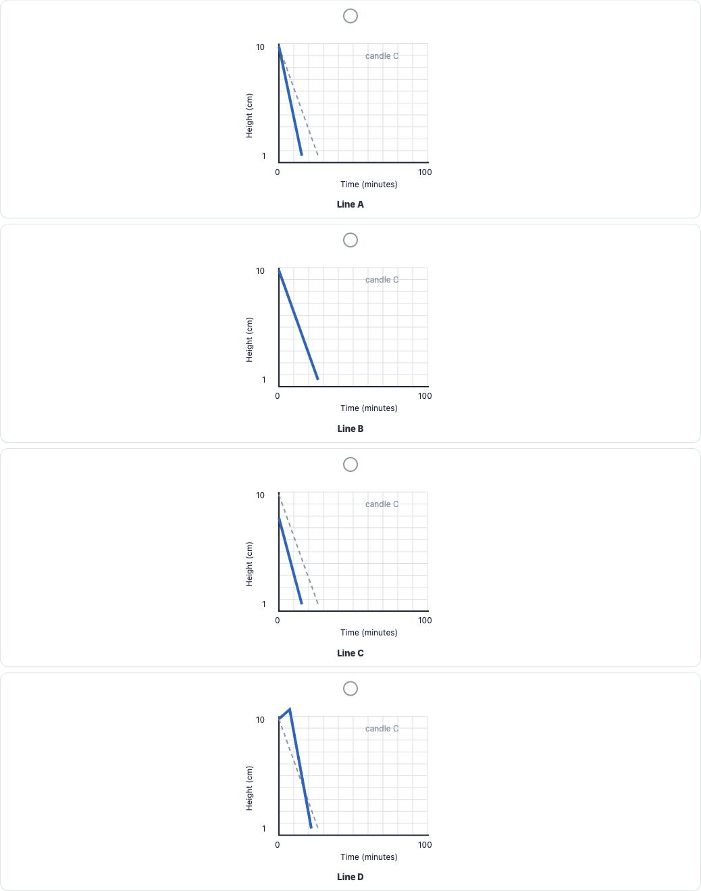
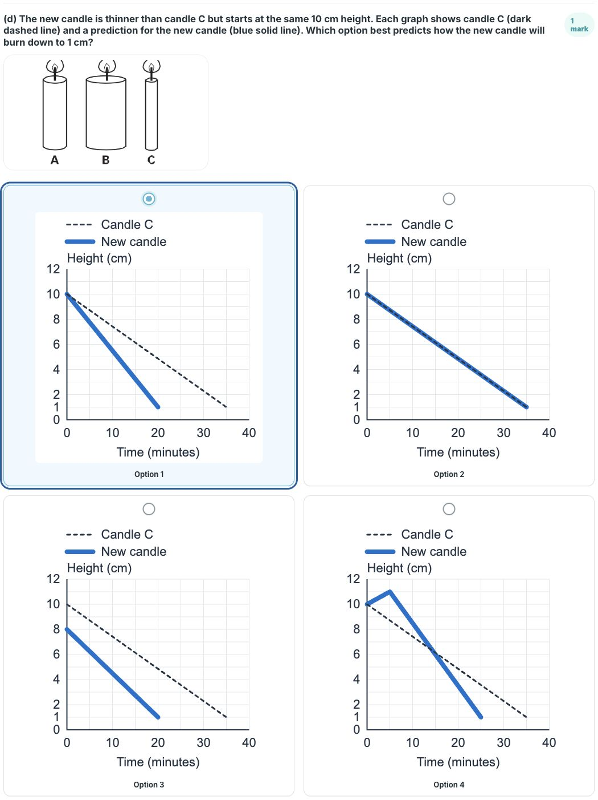
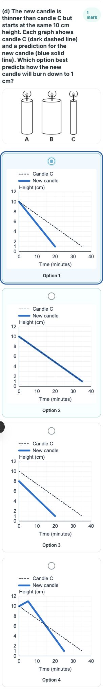

# KS2 Science Progress Test 1: audit fixes

The test retains 37 question parts, 40 marks, the existing response formats and the original partial-credit bands. This change fixes presentation and local/demo marking. Live Supabase grading, test registration and saved results are outside this change.

## Behavior

- The KS2 sections opt into `visualPlacement: "perQuestion"`. Every part keeps its own diagrams and tables; other tests retain the shared-image default.
- Each group displays its source introduction. The ramp investigation states that height is varied, and the shadow question includes the original 9 am reference.
- Question 8(b) accepts either complete relationship, taller/longer or shorter/shorter, through the existing sequence-group grader. Mixed or incomplete combinations earn no mark.
- Question 8(c) uses an explicit inclusive numeric range of 21-26 minutes. Finite decimal responses such as `23.0` and `23.5` work; empty, malformed and out-of-range responses do not. Questions without the new `numericRange` metadata retain their existing marking behavior.
- Scoped KS2 grid sizing keeps the figures inside question cards. Question 8(d) uses four redrawn vector graphs on matching 0-40 minute and 0-12 cm axes, with readable labels and separate keys for candle C and the new candle. Candle C reaches 1 cm at approximately 35 minutes, matching the paper. Dark dashes remain visible over the wider blue prediction when the lines overlap.
- The 8(d) choices are labelled Option 1-4 and display in two columns on desktop and one column below 1024 px. The duplicated full reference graph is removed from 8(d), while 8(c) retains its original graph. The candle-width illustration remains at a compact size. The answer is still stored as `a` and earns one mark; only its displayed label changes to Option 1.

## Verification

- `npm run verify:ks2-science`: 297 original audit cases and 21 additional edge cases pass; the primary response set scores 40/40 and blanks score zero. This check also runs before every build, including Netlify builds.
- All nine 8(b) combinations, numeric boundaries and invalid inputs, and the partial-credit bands for 4(d), 6(e) and 7(b) are covered.
- `node scripts/verify-diagnostic-keys.mjs`: the existing 53-part diagnostic scores 80/80 and passes its 21 regression cases.
- Type checking, lint and the production build pass.
- All eight KS2 sections were checked at 1440x900, 768x1024 and 390x844. All expected assets load, all eight introductions appear, and neither the page nor question cards overflow horizontally.
- A browser demo submission with shorter/shorter for 8(b) and `23.5` for 8(c) scores 2/40, with the other 35 parts blank. No database is used.
- SPIP Year 8 Science still displays four shared image groups and their introductions in its first section. The Combined Science diagnostic still displays three groups and four shared images in its first section.
- The revised 8(d) graphs were inspected at 1440x900, 768x1024 and 390x844: four loaded vector images, two/one/one columns, readable labels, no horizontal overflow, and no duplicated reference graph. Clicking the choice cards and using arrow keys both change the selected answer, with a visible keyboard focus outline. Existing scoring checks confirm only Option 1 earns the mark.

## Before and after

Before: the graph-reading question has no graph.

After: the graph is displayed beside question 8(c).

The restored shadow question includes the morning reference and all four intact alternatives.

Question 8(d) before: small graph labels, compressed lines, and a hidden reference where the two lines overlap.

Question 8(d) after: consistent readable graphs with numbered options and an explicit key.

[Tablet screenshot](ks2-science-evidence/8d-after-tablet.png)

## Source provenance

The original paper is the Standards and Testing Agency's 2012 KS2 Science Sampling Test B, STA/12/5593. The answer reference is STA/12/5591, printed pages 20-35. Crown copyright 2012; the original publication permits reuse under the Open Government Licence.

- [Question paper, clean redistribution](https://www.sats-papers.co.uk/sats-papers/ks2/science/2012/ks2-science-2012-test-b.pdf)
- [Original mark scheme](https://primarytools.co.uk/files/Tests/KS2/science2012/PrimaryTools.co.uk-2012SciKS2MarkScheme.pdf)

The two shadow assets were re-extracted from page 14 rendered with Poppler at 1800 pixels high. Crop bounds in the 1273x1800 page image are `(650, 230, 960, 468)` for the morning reference and `(180, 715, 1035, 1295)` for the choices. The official top-left key is retained.

The four 8(d) SVG alternatives are digital adaptations of the drawing task on paper page 19. All use the same coordinate transform. Candle C runs from (0 minutes, 10 cm) to (35 minutes, 1 cm). The new-candle paths are: Option 1, (0, 10) to (20, 1); Option 2, the same path as candle C; Option 3, (0, 8) to (20, 1); Option 4, (0, 10) to (5, 11) to (25, 1). Only Option 1 satisfies all four official marking conditions.

Review the deployment linked by Netlify on the pull request with `assignment=demo`. Production and the repository's approval rules remain unchanged until the user reviews and approves a merge.
