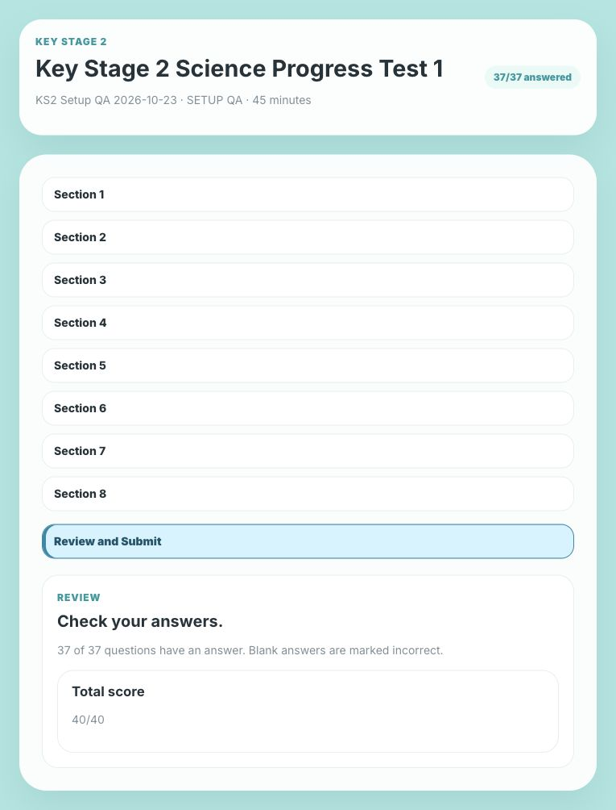

# KS2 Science: live Supabase setup

Project: `KeaesWorkspaceProject` (`xomxithihmrikgzkayfd`). Migration: `20261023090000_register_ks2_science_progress_test_1`.

## Current state

The migration has been applied and recorded in Supabase's migration history. The test is active with 37 question parts, 40 marks and `/tests/ks2-science-progress-test-1/start` as its route. The migration initially registers an inactive test; rerunning it preserves an existing activation status.

The existing `math_part_scores` function now supports an explicit `numericRange` answer part. It trims the same whitespace as the browser, requires a complete decimal string, rejects non-finite/out-of-range values without raising a submission error, and keeps all other normalizers unchanged. The existing assignment, submission and reporting functions are reused. No permissions, security policies, API keys or Edge Functions changed.

**Production staff listing still needs this PR merged.** The previous app catalog filtered out the KS2 ID. This PR adds it to that allowlist and adds an inactive fallback entry; the live database's active status takes precedence. The production student route already works and has been verified against Supabase.

## Verification

- All 318 original KS2 regression cases pass in both the browser scorer and PostgreSQL. Model answers score 40/40; blanks score zero.
- The database also passes 21 existing diagnostic regressions, three SPIP grouped-marking cases and eight additional numeric edge cases, including Unicode whitespace, numeric JSON values and a decimal too large to be finite.
- Before/after checks confirmed unchanged keys and marking behavior for all 350 existing live multipart questions (374 in the repository bootstrap).
- Both Ram and Ekamai assignment flows were tested in rolled-back subtransactions: assignment lookup, 40/40 submission, 37 saved answers, admin report, link closure and duplicate-submission rejection. These checks left no persistent student or result data.
- Before the retained QA attempt, checksums matched for all existing 134 students, 253 assignments, 134 attempts and 4,773 answer rows. After excluding the single retained QA attempt and its related rows, those same checksums still match.
- The migration was applied twice successfully in an isolated PostgreSQL database. Type checking, lint and the production build pass.

## Retained production QA

One synthetic attempt is retained as setup evidence:

- Student: **KS2 Setup QA 2026-10-23**, nickname **SETUP QA**; branch **Ram**.
- Result: **40/40**, with all **37** answers saved and the assignment closed.
- 8(b): **shorter + shorter**, awarded 1/1.
- 8(c): **23.5**, awarded 1/1.
- Attempt ID: `d74ccc7b-4253-40be-9ffb-a1cd1c2c10ba`.
- [Saved admin report (staff login required)](https://keaesconnect.netlify.app/admin/tests/results/d74ccc7b-4253-40be-9ffb-a1cd1c2c10ba).



[Database verification evidence](ks2-science-evidence/supabase-verification.json)

## Reproduce and maintain

From `apps/workspace-next`:

```sh
npm run verify:ks2-science
node scripts/ks2-science-supabase.mjs --audit > /tmp/ks2-audit.sql
node scripts/ks2-science-supabase.mjs --integration > /tmp/ks2-integration.sql
```

The audit SQL checks the registered keys and stateless scoring without writing student data. Integration SQL uses an existing super admin only within the transaction context and rolls back every synthetic row. Run it using the approved database connection.

`--migration` regenerates the targeted migration from the reviewed definition and canonical grader; `--bootstrap` emits the matching seed rows. The build checks both for drift. Apply only the targeted migration to an existing project, never the complete bootstrap schema.

If post-deployment QA fails, deactivate only `ks2-science-progress-test-1` while investigating. Preserve the retained QA result and existing student history. The PR stays open for owner review; GitHub approval rules are unchanged.
